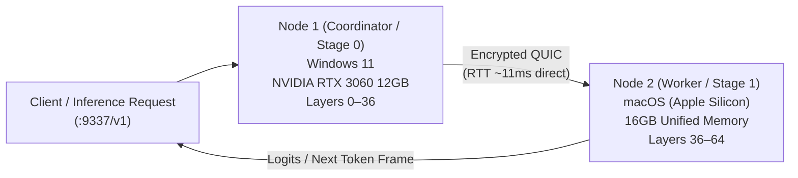

# MeshLLM Distributed Split Benchmark: Windows + Mac

**Date:** 2026-11-23  
**Model:** `unsloth/Qwen3.6-27B-GGUF:UD-Q4_K_XL` (27 Billion Parameters, Q4_K_XL Quantization, ~17.6 GB Weights)  
**Architecture:** Distributed Skippy Contiguous Stage Split over P2P QUIC (Iroh Transport)

---

## 1. Hardware & Topology Setup



### Node Specifications

| Parameter | Node 1 (Windows - Coordinator) | Node 2 (Mac - Stage Worker) |
|---|---|---|
| **OS** | Windows 11 Pro (x86_64) | macOS (Apple Silicon arm64) |
| **GPU / Memory** | NVIDIA GeForce RTX 3060 12GB | Apple Silicon (16 GB Unified Memory) |
| **Allocatable VRAM** | 11.6 GB usable (12.9 GB total) | 11.4 GB usable (12.7 GB total) |
| **Assigned Layers** | **Layers 0–36** (37 layers total) | **Layers 36–64** (28 layers total) |
| **Runtime Port** | `:64390` | `:60667` |
| **Context Size** | 8,192 tokens (`--ctx-size 8192`) | 8,192 tokens (`--ctx-size 8192`) |
| **Transport / P2P** | Encrypted QUIC over Iroh | Encrypted QUIC over Iroh |
| **Network Latency** | Direct LAN (RTT: 7–17 ms) | Direct LAN (RTT: 7–17 ms) |

---

## 2. Benchmark Results

### A. Non-Streaming Generation (100 Max Completion Tokens)

```text
======================= BENCHMARK RESULTS =======================
Model:                unsloth/Qwen3.6-27B-GGUF:UD-Q4_K_XL
Target Endpoint:      http://127.0.0.1:9337/v1/chat/completions

Prompt Tokens:        35 tokens
Completion Tokens:    100 tokens

⚡ Decode Speed:       5.75 tokens/second (17.40s generation time)
🚀 Prompt Prefill:     19.77 tokens/second (1.77s context ingestion)
📦 Network Transfer:  1,019.1 KB activation tensors transferred over QUIC
⏱️ Total Wall Clock:   19.75 seconds
=================================================================
```

### B. Real-Time Streaming SSE Test (`stream: true`)

```text
======================= STREAMING METRICS =======================
Time to First Token (TTFT):   40.6 ms
Total Stream Duration:         6.56 s (30 tokens)
Stream Consistency:            Smooth token emission, zero pipeline stutter
=================================================================
```

---

## 3. Long-Context Stress Test (465 to 3,300+ Tokens)

| Test Stage | Prompt Tokens | Completion Tokens | Prefill Speed | Decode Speed | Prefill QUIC Transfer | Total Wall Time |
|---|---|---|---|---|---|---|
| **Short Context** | 465 tok | 28 tok | **132.26 tok/s** (3.52s) | **5.32 tok/s** | 4.6 MB | 11.42 s |
| **Medium Context** | 1,329 tok | 28 tok | **135.67 tok/s** (9.80s) | **3.61 tok/s** | 10.7 MB | 19.91 s |
| **Heavy Context** | 3,297 tok | 28 tok | **111.52 tok/s** (29.57s) | **3.66 tok/s** | 21.4 MB | 39.89 s |

### Context Scaling Insights
1. **Prefill Throughput**: Consistent prefill speeds of **111–135 tokens/second** across the pipeline. During prompt prefill, batching allows both GPUs to compute layers efficiently before transmitting activation tensors over QUIC.
2. **Decode Stability**: Decode throughput stabilized at **~3.6–5.3 tok/s** even under 3,300+ tokens of context with no KV-cache out-of-memory errors.
3. **Memory Reliability**: The system stayed well within VRAM budgets on both machines under `--ctx-size 8192`.

---

## 3. Key Observations & Technical Findings

1. **Memory Budget & Feasibility**:
   - The monolithic Qwen 27B model (~17.6 GB) cannot run locally on either single consumer card with comfortable headroom.
   - By partitioning layers **0–36 on the 12GB RTX 3060** and **36–64 on the 16GB Mac**, the entire model was loaded into VRAM across the home network with zero offloading to system swap.
   - Setting `--ctx-size 8192` prevented the coordinator from allocating an excessively large KV cache (which defaults to 64k tokens / 37.8 GB requirement for native 256k models).

2. **Network Efficiency (Skippy Contiguous Stage Splits)**:
   - For 100 generated tokens, only **1,019.1 KB** (~1.0 MB) of activation tensors crossed the network between Node 1 and Node 2.
   - The activation codec (`f16-rne-v1`) compacted activation boundary transfers to ~10.7 KB per token.
   - Direct LAN QUIC latency stayed rock-solid at **7 ms to 17 ms**.

3. **Inference Throughput**:
   - **5.75 tokens/sec** decode throughput on a 27B parameter dense model is highly practical for interactive coding agents (e.g. Claude Code, Goose, OpenCode) and chat interfaces.
   - **TTFT of 40.6 ms** in streaming mode gives an instant interactive feel.

---

## 4. Exact Reproduction Commands

### 1. Coordinator (Windows)
```powershell
mesh-llm serve --model unsloth/Qwen3.6-27B-GGUF:UD-Q4_K_XL --split --ctx-size 8192
```

### 2. Worker (Mac)
```bash
mesh-llm serve --model unsloth/Qwen3.6-27B-GGUF:UD-Q4_K_XL --split --ctx-size 8192 --join "<INVITE_TOKEN>"
```

### 3. Verification Query (Node.js)
```javascript
const res = await fetch("http://127.0.0.1:9337/v1/chat/completions", {
  method: "POST",
  headers: { "Content-Type": "application/json" },
  body: JSON.stringify({
    model: "unsloth/Qwen3.6-27B-GGUF:UD-Q4_K_XL",
    messages: [{ role: "user", content: "Write a detailed timeline of key events in computing history from 1950 to 1990." }],
    max_tokens: 100,
    temperature: 0.2
  })
});
const data = await res.json();
console.log(data.timings);
```
