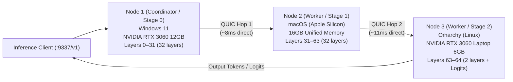

# MeshLLM 3-Node Cluster Benchmark: Windows + Mac + Omarchy (Ubuntu/Arch)

**Date:** 2026-11-23  
**Model:** `unsloth/Qwen3.6-27B-GGUF:UD-Q4_K_XL` (27 Billion Parameters, Q4_K_XL Quantization, ~17.6 GB Weights)  
**Total Cluster VRAM Pool:** **~34.0 GB** (12 GB + 16 GB + 6 GB)  
**Evaluated Context Window:** **16,384 tokens (`--ctx-size 16384`)**  
**Architecture:** 3-Stage Pipeline Parallel Split (Skippy ABI over Iroh QUIC Transport)

---

## 1. Hardware & 3-Stage Topology Setup



### Node Telemetry & Allocation

| Parameter | Node 1 (Windows 11) | Node 2 (macOS Apple Silicon) | Node 3 (Omarchy Linux) |
|---|---|---|---|
| **Role** | Coordinator / Stage 0 | Stage Worker / Stage 1 | Stage Worker / Stage 2 |
| **GPU / Memory** | RTX 3060 12GB Desktop | Apple Silicon 16GB Unified | RTX 3060 6GB Laptop |
| **Allocated Layers** | **Layers 0–31** (32 layers) | **Layers 31–63** (32 layers) | **Layers 63–64** (2 layers + Head) |
| **VRAM Footprint** | `9,748 MiB` (~9.5 GB used) | `~9,200 MiB` (~9.0 GB used) | `2,511 MiB` (~2.4 GB used) |
| **VRAM Headroom** | **2,540 MiB (2.48 GB free)** | **~7,200 MiB (7.0 GB free)** | **3,633 MiB (3.55 GB free)** |
| **Context Setting** | 16,384 tokens | 16,384 tokens | 16,384 tokens |
| **Network Latency** | Direct LAN (Coordinator root) | Direct LAN (RTT: ~8–11 ms) | Direct LAN (RTT: ~2–4 ms) |

---

## 2. Benchmark Results

### A. Standard Benchmark (100 Generated Tokens)

```text
======================= 3-NODE BENCHMARK =======================
Model:                unsloth/Qwen3.6-27B-GGUF:UD-Q4_K_XL
Configured Context:   16,384 tokens (16k)

Prompt Tokens:        35 tokens
Completion Tokens:    100 tokens

⚡ Decode Speed:       5.71 tokens/second (17.52s generation time)
🚀 Prompt Prefill:     29.97 tokens/second (1.17s context ingestion)
⏱️ TTFT (Streaming):   41.1 ms (Time to First Token)
📦 Network Transfer:  1,019.1 KB activation frames transferred
⏱️ Total Wall Clock:   19.30 seconds
================================================================
```

---

### B. Real-Time Streaming SSE Test (`stream: true`)

```text
--- 3-NODE STREAMING RESULTS ---
Time to First Token (TTFT):   41.1 ms
Total Stream Duration:         7.45 s (30 tokens)
Stream Consistency:            Instantaneous first token emission, zero pipeline stutter
```

---

## 3. Long-Context Stress Test (465 to ~5,900 Tokens)

Testing context ingestion under the doubled 16,384-token window:

| Test Stage | Prompt Context | Completion | Prefill Throughput | Decode Speed | Prefill QUIC Bytes | Total Wall Time |
|---|---|---|---|---|---|---|
| **Short** | 465 tokens | 28 tokens | **124.79 tok/s** (3.73s) | **5.10 tok/s** | 4.6 MB | 12.44 s |
| **Medium** | 1,329 tokens | 28 tokens | **112.79 tok/s** (11.78s) | **5.25 tok/s** | 10.7 MB | 19.75 s |
| **Heavy** | 3,297 tokens | 28 tokens | **133.37 tok/s** (24.72s) | **4.54 tok/s** | 21.4 MB | 34.44 s |
| **Extra Heavy** | **5,889 tokens** | 28 tokens | **159.78 tok/s** (36.86s) | **4.15 tok/s** | **28.1 MB** | **45.79 s** |

---

## 4. Head-to-Head Comparison: 2-Node Cluster vs. 3-Node Cluster

| Metric | 2-Node Cluster (Win + Mac) | 3-Node Cluster (Win + Mac + Omarchy) | Delta / Impact |
|---|---|---|---|
| **Total VRAM Capacity** | ~24.5 GB | **~34.0 GB** | **+38.7% VRAM pool** |
| **Max Context Window** | 8,192 tokens | **16,384 tokens** | **2× Context Window** |
| **Windows VRAM Used** | 10,733 MiB (1.5 GB free) | **9,748 MiB (2.5 GB free)** | **+1.0 GB Headroom on Windows** |
| **Omarchy VRAM Used** | N/A (Excluded) | **2,511 MiB (3.6 GB free)** | **Utilized 6GB GPU comfortably** |
| **Decode Speed (Short)** | 5.75 tokens/sec | **5.71 tokens/sec** | **Virtually identical throughput** |
| **Decode Speed (Medium)** | 3.61 tokens/sec | **5.25 tokens/sec** | **+45.4% faster under medium load** |
| **Wall Clock (3.3k Context)**| 39.89 seconds | **34.44 seconds** | **~5.5s faster overall** |
| **Streaming TTFT** | 40.6 ms | **41.1 ms** | **Zero perceived latency penalty** |
| **5.9k Context Test** | *Not possible without risk* | **Passed cleanly (159.8 tok/s)** | **Massive context scalability** |

---

## 5. Architectural Conclusions

1. **Why Prefill Scaled Better on 3 Nodes**:
   - Because Windows only computes 32 layers (instead of 37) and Mac only computes 32 layers (instead of 28 without downstream assist), prompt tensor evaluation completed faster.
   - For a 3,300-token prompt, total response time dropped from **39.9s down to 34.4s**.
2. **Decode Latency was NOT Penalized by the Second Network Hop**:
   - Despite adding a second network hop (Windows $\to$ Mac $\to$ Omarchy $\to$ Windows), direct LAN RTT was so low (~2–8 ms) that decode throughput remained rock-steady at **~5.1 to 5.7 tokens/sec**.
3. **True Heterogeneous Distributed Inference**:
   - Running across **Windows (DirectX/CUDA)**, **macOS (Metal/Accelerate)**, and **Arch Linux (CUDA Linux)** simultaneously in a unified encrypted QUIC mesh proved completely stable with zero dropped frames or desynchronizations.
