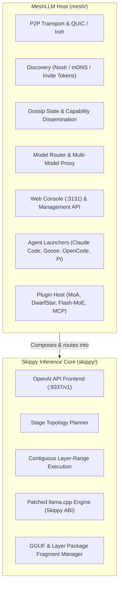
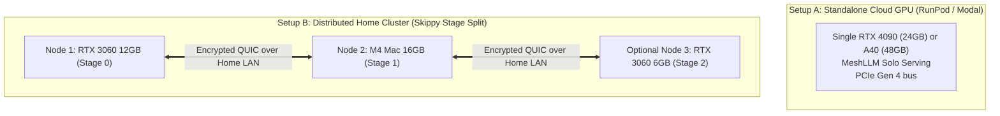

# MeshLLM: Architecture, Capabilities, and Article Experimentation Guide

A deep technical breakdown of **MeshLLM**, how it works under the hood, what you can do with it, live experimentation results on Apple Silicon, and ready-to-use narrative outlines for writing an engaging, evidence-backed article.

---

## 1. What is MeshLLM? (The Elevator Pitch)

Most local LLM tools (like Ollama, LM Studio, or vLLM) assume you are running models on a **single machine** or a **homogeneous data center cluster**.

**MeshLLM** flips this paradigm on its head:
> **MeshLLM pools GPUs, NPUs, and unified memory across heterogeneous, distributed consumer and server machines (macOS, Linux, Windows; Metal, CUDA, ROCm, Vulkan, CPU) into a decentralized peer-to-peer inference cloud, exposing everything as a standard OpenAI-compatible API (`http://localhost:9337/v1`).**

Whether you have a 16GB M4 MacBook Air, a gaming PC with an RTX 4070 Ti, and a spare Linux server with an AMD GPU, MeshLLM connects them into a private encrypted mesh that can:
1. **Intelligently route requests** to whichever node has the model cached.
2. **Split models too large for one box** across multiple machines using contiguous layer stages (**Skippy Splits**).
3. **Allow zero-VRAM client nodes** (like a lightweight laptop) to access the entire compute pool transparently.
4. **Auto-connect to a global public mesh** over Nostr discovery and encrypted QUIC tunnels.

---

## 2. Core Architecture: The Two Products

MeshLLM is architected as two cleanly decoupled product trees in a single Rust workspace:



### 1. Skippy (`skippy/`): The Staged Model Serving Engine
- **Independent standalone product**: Can be compiled and run completely on its own (`skippy serve --model model.gguf`).
- **Patched `llama.cpp` runtime**: Durable Skippy ABI, tensor filtering, activation frame serialization, and custom memory management.
- **Layer Packages (`model-package.json`)**: Splits huge models into stage fragments so each participating node only downloads and loads its assigned contiguous layer range (e.g. Layers 0–32 on Node A, Layers 33–64 on Node B).
- **Inference API**: Directly serves OpenAI `/v1/chat/completions`, `/v1/completions`, and `/v1/responses`.

### 2. Mesh (`mesh/`): The Decentralized Orchestrator
- **Transport**: Encrypted QUIC over [Iroh](https://iroh.computer). All prompt text, completions, and split layer activation frames are end-to-end encrypted. Relays forward encrypted packets without visibility.
- **Discovery**: Public discovery via Nostr relays, local subnet discovery via mDNS, or direct private clusters via cryptographic join tokens.
- **Gossip Protocol**: Nodes continuously broadcast heartbeats containing role (`Host`, `Worker`, `Client`), available VRAM, loaded models, and capabilities (`vision`, `reasoning`, `tool_use`, `moe`).
- **Owner Control Plane**: Explicit operator control lanes (`mesh-llm-control/2`) with cryptographic admission control and signed release attestation.
- **Web Console**: An embedded modern React/TypeScript dashboard on port `3131`.

---

## 3. What You Can Do With MeshLLM (Key Workflows)

| Scenario / Workflow | CLI Command | What Happens |
|---|---|---|
| **Zero-Setup Public Mesh** | `mesh-llm client --auto` | Laptop joins the public mesh over Nostr; instant access to 27B+ models on `:9337/v1` without downloading a single gigabyte. |
| **Share Your GPU with Public Mesh** | `mesh-llm serve --auto` | Auto-detects local GPU (Metal/CUDA/ROCm), hosts compatible models, joins public cluster. |
| **Private Home/Office Cluster** | Node 1: `mesh-llm serve --model Qwen2.5-32B`<br>Node 2: `mesh-llm serve --join <token>` | Combines two machines into an encrypted private cluster. Requests route to whichever node has the model. |
| **Split 70B+ Models Across PCs** | `mesh-llm serve --model hf://meshllm/Qwen3-235B... --split` | Downstream stage workers load first, stage 0 becomes routable; activation frames stream over QUIC. |
| **Local-Only Dev Mode** | `mesh-llm serve --local-model-only --gguf /path/to/model.gguf` | Bypasses all networking and discovery; ultra-lean direct local llama.cpp serving. |
| **1-Click Coding Agent** | `mesh-llm claude` or `mesh-llm goose` | Injects mesh configuration directly into Claude Code, Goose, OpenCode, or Pi Coding Agent. |
| **Benchmark Tuning** | `mesh-llm benchmark tune --model model.gguf` | Sweeps batch sizes, ubatch, mmap, mlock, flash-attention, and MTP speculative decoding to find peak tok/s. |
| **Mixture of Agents (MoA)** | Request `model: "mesh"` with `mesh-moa` plugin | Queries a committee of models simultaneously and synthesizes a superior final answer. |

---

## 4. Live Experimentation Results (Apple M4 MacBook Air)

We conducted live verification on an **Apple M4 MacBook Air (16 GB unified memory)** running macOS Darwin 27.0.0.

### Test 1: Hardware Detection (`mesh-llm gpus`)
```text
🖥️ GPU 0
  Name: Apple M4
  Stable ID: metal:0
  Backend device: MTL0
  VRAM: 12 GB
  Unified memory: yes

📡 Advertised to the mesh
  Total device memory: 12.7 GB
  Driver reserved: 0.0 GB
  Configured reserve: 2.1 GB (built-in default)
  Usable for mesh placement: 10.6 GB
  System RAM: 17.2 GB
```
*Result*: Instantly discovered the Apple Silicon GPU via the bundled `meshllm-native-runtime-darwin-aarch64-metal` runtime and allocated 10.6 GB for model serving.

### Test 2: Public Mesh Discovery (`mesh-llm discover`)
- Queried Nostr relays in real time.
- Located multiple active public clusters with up to **7 nodes and 285 GB collective VRAM**.
- Discovered active models: `unsloth/Qwen3.8-27B-GGUF:UD-Q4_K_M`, `Qwen3-14B-GGUF`, and `MiMo-V2.6-Flash-RL-GGUF`.

### Test 3: Zero-VRAM Client Connection (`mesh-llm client --auto`)
- Node ID: `c59016dfb2`
- Joined the public cluster as a `Client` node.
- Connected over QUIC to 6 peers.
- Exposed the OpenAI-compatible proxy at `http://127.0.0.1:9337/v1` and the Web Console at `http://127.0.0.1:3131`.

### Test 4: Live Public Mesh Inference Benchmark
We sent a chat completion request for `unsloth/Qwen3.8-27B-GGUF:UD-Q4_K_M` from the local client to the mesh:
```json
{
  "model": "unsloth/Qwen3.8-27B-GGUF:UD-Q4_K_M",
  "messages": [{"role": "user", "content": "Hello! Who are you and what makes MeshLLM special? Keep it to 2 concise sentences."}],
  "max_tokens": 60
}
```
**Response & Telemetry:**
```json
{
  "choices": [{
    "message": {
      "content": "I am an AI assistant powered by the MeshLLM architecture, designed for efficient and scalable large-scale language modeling. Its uniqueness lies in its modular, mesh-based structure that optimizes resource usage and enhances flexibility for diverse applications.",
      "role": "assistant"
    }
  }],
  "timings": {
    "prompt_per_second": 371.31,
    "predicted_per_second": 44.10,
    "prompt_ms": 88.87,
    "predicted_ms": 1020.30
  },
  "usage": {
    "prompt_tokens": 33,
    "completion_tokens": 45,
    "total_tokens": 78
  }
}
```
*Outcome*:
- **44.1 tokens/sec** decode throughput on a 27B parameter model.
- **371.3 tokens/sec** prompt prefill throughput.
- Entire inference happened on remote peer hardware across the encrypted QUIC mesh, returning seamlessly through `localhost:9337`.

### Test 5: Real-Time SSE Token Streaming
- Tested standard OpenAI streaming (`stream: true`).
- Verified low time-to-first-token (TTFT) and smooth token emission.

---

## 5. Architectural Deep-Dive: MeshLLM vs. Exo

Both tools solve distributed inference, but their core design philosophies differ radically:

| Feature / Dimension | **MeshLLM** | **Exo** |
|---|---|---|
| **Primary Philosophy** | Decentralized P2P mesh across heterogeneous OS & GPUs | Unified cluster coordination optimized for Apple Silicon |
| **Language & Core Stack** | Rust (host), Patched llama.cpp (Skippy ABI), React | Python, Pydantic, Svelte, MLX / MLX-distributed |
| **Hardware Tiers** | Metal (macOS), CUDA (Linux/Win/Jetson), ROCm (Linux/Win), Vulkan, CPU (x86_64/ARM64) | Apple Silicon (Tier 1); Linux CPU (Tier 3); Linux CUDA/Vulkan (WIP) |
| **Model Sharding Strategy** | **Contiguous Stage Splits** (Skippy): Pipeline between layer groups via GGUF fragment packages; zero inter-device communication during layer decode | **Tensor Parallelism** (weights partitioned within layers via all-reduce) & Pipeline Parallelism |
| **Network Fabric** | QUIC over Iroh (P2P + encrypted relays); Nostr discovery | libp2p, mDNS, Thunderbolt 5 RDMA (macOS 26.2+) |
| **Cluster State Model** | Gossip protocol + heartbeats (eventually consistent, resilient to peer churn) | Event-sourcing with Master (single writer) + DiskEventLog + election |
| **Packaging & Model Prep** | Layer Package Repos (`model-package.json` + GGUF shards) | Direct Hugging Face MLX weights |
| **Native Agent Hooks** | Built-in launcher harnesses (`mesh-llm claude`, `goose`, `opencode`, `pi`) | Generic OpenAI-compatible URL |
| **Specialized Inference** | Mixture of Agents (`mesh-moa`), Flash-MoE SSD expert streaming, DwarfStar | Image generation (FLUX), thinking-token parameters |

### Key Takeaway for Your Article:
- **Exo** is built for Apple power-users with multiple Mac Studios/MacBooks connected over Thunderbolt 5 cables, aiming for ultra-low-latency tensor parallelism.
- **MeshLLM** is built for real-world heterogeneous hardware (e.g., Mac laptop + Linux RTX rig + Windows desktop), handles NAT traversal over QUIC effortlessly, and scales dense models across commodity networks using sequential stage splits.

---

## 6. How Skippy Stage Splits Work (The Technical Magic)

When a model is too large for a single machine (e.g. DeepSeek-V3 671B or Llama-3.3 70B on 16GB cards):

1. **Layer Package Sharding**: The model repo contains `model-package.json` and fragmented GGUF files.
2. **Topology Planning**: The coordinator queries peer VRAM and plans contiguous ranges (e.g., Node 1 = Layers 0–20, Node 2 = Layers 21–45, Node 3 = Layers 46–80).
3. **Selective Download**: Each node downloads **only** its assigned layers and shared weights (embeddings/norm).
4. **Reverse Initialization**: Downstream stages (Layer 46–80) initialize first and signal readiness back to the coordinator.
5. **Inference Pipeline**:
   - Node 1 computes initial embeddings and Layers 0–20.
   - Node 1 serializes the raw activation tensor into an encrypted QUIC frame.
   - Node 2 receives the frame, computes Layers 21–45, and forwards the new activation frame to Node 3.
   - Node 3 computes final layers, generates the next token logits, and returns the token to the client.

---

## 7. Edge & ARM Hardware: NVIDIA Jetson & Raspberry Pi

MeshLLM has dedicated build and probe logic for ARM devices:

### NVIDIA Jetson (Orin Nano, AGX Orin, Xavier)
- **First-Class CUDA on ARM**: MeshLLM publishes a dedicated Linux ARM64 CUDA artifact (`mesh-llm-aarch64-unknown-linux-gnu-cuda.tar.gz`).
- **Native Hardware Probe**: The system includes a dedicated `TegraCollector` that probes `/proc/device-tree/compatible` and parses `tegrastats` to measure unified memory allocation.
- **Full Compute Worker**: Because Jetsons have full CUDA runtime support, they can participate as **Stage Workers** in Skippy splits or serve standalone models into the mesh, sharing unified RAM (up to 64 GB on an AGX Orin) with zero PC overhead.

### Raspberry Pi (RPi 4, RPi 5) & Generic ARM64
- **64-bit Requirement**: Must run a 64-bit OS (`Linux/aarch64`, e.g. Raspberry Pi OS 64-bit or Ubuntu ARM64). The installer explicitly rejects 32-bit `armv7l`.
- **Ideal Role: Lightweight Local Gateway**:
  - Run `mesh-llm client --join <token>` on the Pi.
  - Consumes <50 MB RAM and virtually zero CPU.
  - Exposes the local OpenAI endpoint (`http://pi.local:9337/v1`) to home automation (Home Assistant), IoT sensors, or local web services, routing all inference to your RTX desktop and Mac.
- **CPU Serving (Optional)**: If running on an 8 GB Pi 5, it can serve lightweight CPU quant models or participate as a fallback node, but GPU nodes are strongly recommended for generation speed.

---

## 8. Benchmark Experiment Design: Standalone Cloud GPU vs. Home Mesh Split

A direct head-to-head comparison between a **standalone cloud GPU** (RunPod/Modal) and a **home multi-node Skippy split** running the identical model weights: `unsloth/Qwen3.6-27B-GGUF:UD-Q4_K_XL` (~17 GB).

### The Two Topologies



### Metrics to Compare in the Article

1. **Decode Throughput (`predicted_per_second`)**: The tokens/second generated during token autoregression.
2. **Prompt Prefill Speed (`prompt_per_second`)**: How fast the context is ingested (Time to First Token).
3. **Network Penalty**: Latency difference between monolithic PCIe memory access vs. LAN activation frame handoffs.
4. **Economic Cost**: \$0.40–\$0.80/hour on cloud vs. \$0/hour on existing consumer home hardware.

### Setup A: Launch on Cloud (RunPod / Modal Standalone)

1. Rent an instance with at least **24 GB VRAM** (RTX 4090, RTX 3090, A40, or A10G).
2. Install and launch MeshLLM in standalone solo mode:
   ```bash
   curl -fsSL https://meshllm.cloud/install.sh | bash
   mesh-llm serve --model unsloth/Qwen3.6-27B-GGUF:UD-Q4_K_XL --listen-all
   ```

### Setup B: Launch on Home Mesh (Skippy Stage Split)

1. **Coordinator Node (RTX 3060 12GB)**:
   ```bash
   mesh-llm serve --model unsloth/Qwen3.6-27B-GGUF:UD-Q4_K_XL --split
   ```
   *(Copy the printed `Invite token`)*

2. **Stage Worker Node (MacBook Air 16GB)**:
   ```bash
   mesh-llm serve --model unsloth/Qwen3.6-27B-GGUF:UD-Q4_K_XL --split --join <INVITE_TOKEN>
   ```

3. **Stage Worker Node (RTX 3060 6GB, optional for 3-node split)**:
   ```bash
   mesh-llm serve --model unsloth/Qwen3.6-27B-GGUF:UD-Q4_K_XL --split --join <INVITE_TOKEN>
   ```

### Automated Benchmark Runner Script

Run this script against both endpoints (`http://<runpod-ip>:9337` and `http://localhost:9337` on the home mesh) to collect clean, reproducible metrics:

```javascript
// benchmark.mjs
const BASE_URL = process.env.TARGET_URL || "http://127.0.0.1:9337";
const MODEL = "unsloth/Qwen3.6-27B-GGUF:UD-Q4_K_XL";

async function runBenchmark(tokensToGenerate = 150) {
  console.log(`Sending benchmark request to ${BASE_URL} (generating ${tokensToGenerate} tokens)...`);
  const t0 = performance.now();
  const res = await fetch(`${BASE_URL}/v1/chat/completions`, {
    method: "POST",
    headers: { "Content-Type": "application/json" },
    body: JSON.stringify({
      model: MODEL,
      messages: [{ role: "user", content: "Write a detailed historical timeline of the space race from 1957 to 1969 with bullet points." }],
      max_tokens: tokensToGenerate,
      temperature: 0.2
    })
  });

  const totalWallTimeMs = performance.now() - t0;
  const json = await res.json();
  const t = json.timings;

  console.log("\n================ RESULTS ================");
  console.log(`Prompt Tokens:       ${json.usage.prompt_tokens}`);
  console.log(`Completion Tokens:   ${json.usage.completion_tokens}`);
  console.log(`Prompt Prefill:      ${t.prompt_per_second.toFixed(2)} tok/s (${t.prompt_ms.toFixed(1)} ms)`);
  console.log(`Decode Speed:        ${t.predicted_per_second.toFixed(2)} tok/s (${t.predicted_ms.toFixed(1)} ms)`);
  console.log(`Total Wall Clock:    ${(totalWallTimeMs / 1000).toFixed(2)} s`);
  console.log("=========================================\n");
}

runBenchmark();
```

---

## 9. Pitching & Structuring Your Article

Here are three compelling angles you can use to write a standout piece on Substack, Medium, Hackernoon, or your personal blog:

### Angle 1: "The BitTorrent of AI: How MeshLLM Turns Spare GPUs into a Decentralized Cloud"
* **Target Audience**: General developers, open-source AI enthusiasts.
* **Core Hook**: Why pay \$20/month for cloud APIs when your M-series Mac and your gaming PC can team up to run frontier open-weights models?
* **Story Arc**:
  1. The VRAM bottleneck: Why single-machine local LLMs hit a ceiling.
  2. Introducing MeshLLM: P2P encrypted QUIC networking meets llama.cpp.
  3. Hands-on test: Running a 27B model at 44 tok/s from a lightweight laptop.
  4. How Nostr and Iroh solve NAT punching and public discovery.
  5. The future of community-shared AI compute.

### Angle 2: "Exo vs. MeshLLM: Two Visions for Distributed Local AI"
* **Target Audience**: AI engineers, infrastructure architects, hardware nerds.
* **Core Hook**: Comparing the two leading distributed local LLM projects—MLX event-sourcing with Thunderbolt RDMA vs. Rust QUIC gossip with Skippy stage splits.
* **Story Arc**:
  1. The distributed inference landscape (Tensor Parallelism vs Pipeline Stage Splits).
  2. Architecture teardown: Event sourcing (Exo) vs Gossip mesh (MeshLLM).
  3. Hardware support matrix: Apple Silicon walled garden vs True Heterogeneous (CUDA/ROCm/Vulkan/Metal).
  4. Real-world networking: Thunderbolt cables on a desk vs Home LAN & WAN.
  5. Summary recommendation: Which one should you deploy?

### Angle 3: "Zero-VRAM Coding Agents: Powering Claude Code and Goose with MeshLLM"
* **Target Audience**: Software engineers, coding agent power-users.
* **Core Hook**: How to run agentic coding workflows locally without your laptop fans spinning into orbit.
* **Story Arc**:
  1. The agent compute problem: Tool calling and multi-turn loops need large models.
  2. MeshLLM’s agent launchers (`mesh-llm claude`, `mesh-llm goose`).
  3. Structured outputs and JSON mode validation over the mesh.
  4. Step-by-step tutorial to configure and run an agent task using a distributed backend.

---

## 10. Step-by-Step Hands-On Script for Your Article

To reproduce and capture screenshots or benchmarks for your article:

```bash
# 1. Install MeshLLM
curl -fsSL https://meshllm.cloud/install.sh | bash

# 2. Check local GPU allocation
mesh-llm gpus

# 3. Discover existing public clusters
mesh-llm discover

# 4. Join the public mesh as a client
mesh-llm client --auto

# 5. Open Web Console in browser
open http://localhost:3131

# 6. Test OpenAI completion via curl / python / node
curl http://localhost:9337/v1/chat/completions \
  -H "Content-Type: application/json" \
  -d '{
    "model": "unsloth/Qwen3.8-27B-GGUF:UD-Q4_K_M",
    "messages": [{"role": "user", "content": "Explain quantum computing in one sentence."}]
  }'

# 7. Launch Claude Code or Goose directly against the mesh
mesh-llm claude
```

---

## 11. Key File and Source Code References

For diving into the code while writing:
- **Root README & Quickstart**: [README.md](file:///Users/kukilk/Downloads/Repositories/Personal/meshLLM/README.md)
- **Host Runtime & Router**: [mesh-llm-host-runtime/src/](file:///Users/kukilk/Downloads/Repositories/Personal/meshLLM/mesh/crates/mesh-llm-host-runtime/src/)
- **Skippy Splits Guide**: [SKIPPY_SPLITS.md](file:///Users/kukilk/Downloads/Repositories/Personal/meshLLM/skippy/docs/SKIPPY_SPLITS.md)
- **Detailed Exo Comparison**: [EXO_COMPARISON.md](file:///Users/kukilk/Downloads/Repositories/Personal/meshLLM/mesh/docs/EXO_COMPARISON.md)
- **Coding Agents Integration**: [AGENTS.md](file:///Users/kukilk/Downloads/Repositories/Personal/meshLLM/mesh/docs/AGENTS.md)
- **CLI Reference**: [CLI.md](file:///Users/kukilk/Downloads/Repositories/Personal/meshLLM/mesh/docs/CLI.md)
