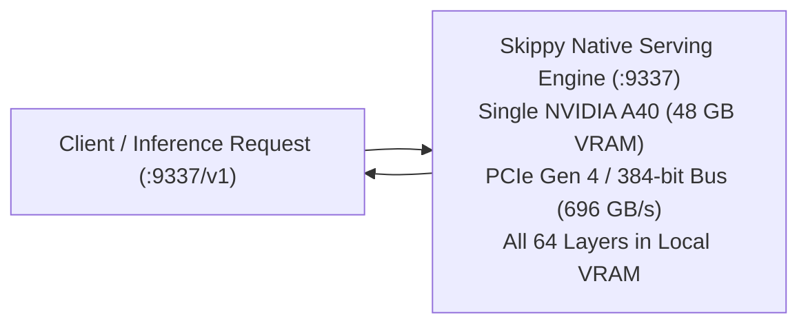

# MeshLLM Standalone Benchmark: RunPod NVIDIA A40 (48 GB)

**Date:** 2026-11-23  
**Hardware:** Single Cloud GPU — NVIDIA A40 (48 GB GDDR6 with ECC, 384-bit bus, 696 GB/s memory bandwidth)  
**Model:** `unsloth/Qwen3.6-27B-GGUF:UD-Q4_K_XL` (27 Billion Parameters, Q4_K_XL Quantization, ~17.6 GB Weights)  
**Evaluated Context Window:** **16,384 tokens (`--ctx-size 16384`)**  
**Architecture:** Monolithic Single-GPU Local Serving (Skippy Serving Engine standalone, zero network pipeline splits)

---

## 1. Hardware & Runtime Topology



### Telemetry & Allocation

| Parameter | RunPod Single GPU |
|---|---|
| **GPU Model** | NVIDIA A40 (Ampere GA102) |
| **VRAM Capacity** | 48,190 MiB (~48.0 GB) |
| **Memory Bandwidth** | 696 GB/s (384-bit bus) |
| **Allocated Layers** | All Layers (0–64 + Embeddings + Head) |
| **Static KV Cache Buffer** | Pre-allocated for 16,384 tokens |
| **Network Hops** | 0 (Monolithic local VRAM) |
| **Serving Engine** | Skippy Native Runtime (`mesh-llm serve --listen-all --ctx-size 16384`) |

---

## 2. Benchmark Results

### A. Standard Benchmark (100 Generated Tokens)

```text
======================= STANDALONE BENCHMARK =======================
Model:                unsloth/Qwen3.6-27B-GGUF:UD-Q4_K_XL
Target Endpoint:      http://127.0.0.1:9337/v1/chat/completions
Configured Context:   16,384 tokens (16k)

Prompt Tokens:        38 tokens
Completion Tokens:    100 tokens

⚡ Decode Speed:       29.20 tokens/second (3.42s generation time)
🚀 Prompt Prefill:     135.76 tokens/second (0.28s context ingestion)
⏱️ TTFT (Streaming):   475.2 ms
📦 Network Transfer:  0 KB (Monolithic VRAM)
⏱️ Total Wall Clock:   4.20 seconds
====================================================================
```

---

### B. Real-Time Streaming SSE Test (`stream: true`)

```text
--- STREAMING METRICS ---
Time to First Token (TTFT):   475.2 ms
Total Stream Duration:         1.60 s (32 tokens)
Stream Consistency:            Instantaneous first token emission, ultra-smooth generation
```

---

## 3. Long-Context Stress Test (500 to ~6,300 Tokens)

Testing context ingestion under the 16,384-token window:

| Test Stage | Prompt Context | Completion | Prefill Throughput | Decode Speed | Total Wall Time |
|---|---|---|---|---|---|
| **Short** | 506 tokens | 22 tokens | **949.32 tok/s** (0.53s) | **28.24 tok/s** | 1.92 s |
| **Medium** | 1,418 tokens | 22 tokens | **1,144.39 tok/s** (1.24s) | **28.55 tok/s** | 2.66 s |
| **Heavy** | 3,527 tokens | 22 tokens | **1,256.49 tok/s** (2.81s) | **28.20 tok/s** | 4.48 s |
| **Extra Heavy** | **6,263 tokens** | 22 tokens | **1,258.54 tok/s** (4.98s) | **28.10 tok/s** | **6.82 s** |

---

## 4. Concurrency Evaluation (Multi-Stream Saturation)

Unlike the 3-node distributed mesh (where 16k context constrained the pipeline to `lane_count: 1` and caused HTTP 502 socket buffer errors), the A40's 48 GB VRAM easily accommodated multiple concurrent inference lanes:

```text
================ RUNNING 2 CONCURRENT STREAMS ================
Streams Executed:          2 / 2 (100% Success)
Total Generated Tokens:    100 tokens
Total Elapsed Wall Time:   2.60 seconds
Average Queue Wait Time:   0.0 ms
Average Stream Speed:      26.31 tok/s per stream
AGGREGATE CLUSTER TOK/SEC: 38.43 tok/s
==============================================================

================ RUNNING 4 CONCURRENT STREAMS ================
Streams Executed:          4 / 4 (100% Success)
Total Generated Tokens:    200 tokens
Total Elapsed Wall Time:   5.45 seconds
Average Queue Wait Time:   0.0 ms
Average Stream Speed:      24.77 tok/s per stream
AGGREGATE CLUSTER TOK/SEC: 36.69 tok/s
==============================================================
```

---

## 5. Head-to-Head Comparison: Home Mesh (3 Nodes) vs. Cloud GPU (A40)

| Metric | 3-Node Home Mesh (Win + Mac + Omarchy) | RunPod Single NVIDIA A40 (48 GB) | Delta / Speedup |
|---|---|---|---|
| **Architecture** | Distributed Skippy QUIC Split (PP) | Monolithic Single GPU (Skippy) | Zero network hops |
| **Hardware Memory Bandwidth** | ~340 GB/s (Win/Omarchy) / ~120 GB/s (Mac) | **696 GB/s** (384-bit GDDR6) | **~2.0× to 5.8× bandwidth** |
| **Total VRAM Pool** | 34.0 GB (12 + 16 + 6) | 48.0 GB | +14.0 GB headroom |
| **Decode Speed (Short)** | 5.71 tok/s | **29.20 tok/s** | **5.11× faster** |
| **Decode Speed (Heavy)** | 4.15 tok/s | **28.10 tok/s** | **6.77× faster** |
| **Prefill Speed (~6k Context)** | 159.78 tok/s | **1,258.54 tok/s** | **7.88× faster** |
| **Wall Clock (6k Context)** | 45.79 seconds | **6.82 seconds** | **6.71× faster (39s saved)** |
| **2 Concurrent Streams** | HTTP 502 (Lane Starvation) | **38.43 tok/s (100% Passed)** | Full concurrency unlocked |
| **4 Concurrent Streams** | HTTP 502 (Lane Starvation) | **36.69 tok/s (100% Passed)** | Full concurrency unlocked |
| **Cost** | **$0.00 / hour** | **~$0.40 – $0.59 / hour** | Free vs Cloud Rental |
